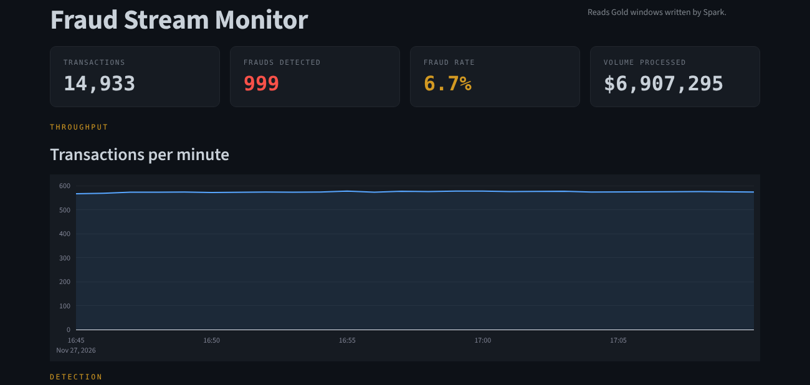
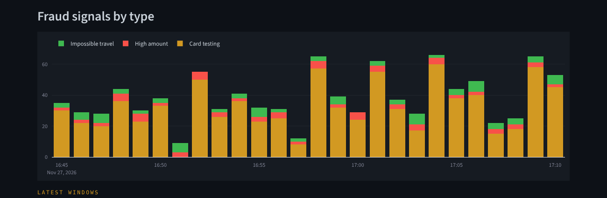
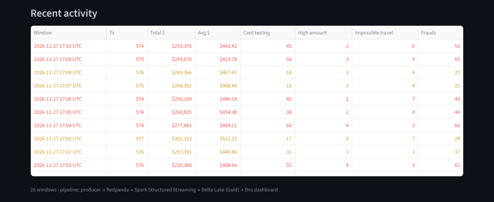
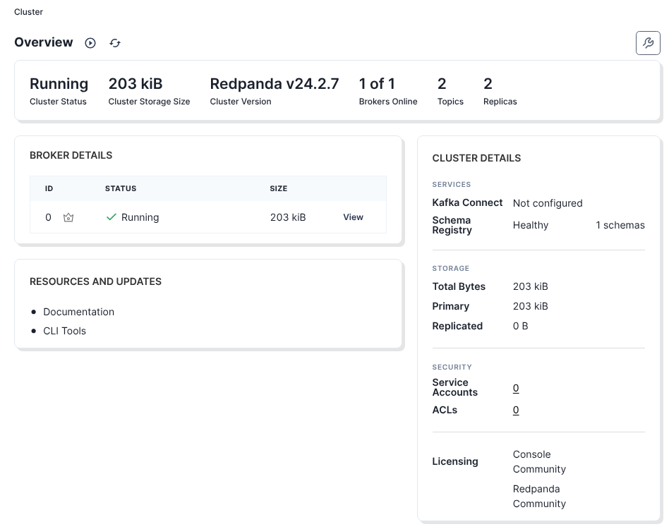
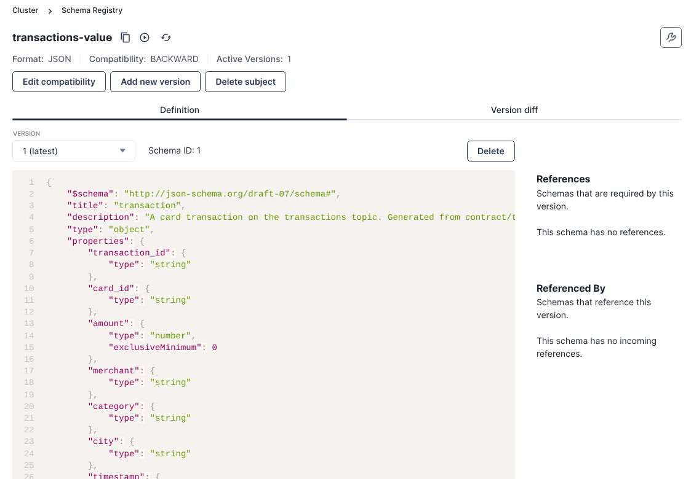

# Real-Time Fraud Stream Monitor

[](https://github.com/DiegoTDDD/realtime-fraud-streaming/actions/workflows/tests.yml)
[](https://github.com/DiegoTDDD/realtime-fraud-streaming/actions/workflows/pipeline-check.yml)
[](LICENSE)

**Problem.** Card fraud happens in seconds, and its signal is in patterns over time, such as a burst of tiny charges or a purchase far from home, rather than in any single transaction. A nightly batch report sees it a day late.

**Solution.** A streaming pipeline that moves card transactions from Redpanda (Kafka API) through Spark Structured Streaming into Parquet layers and a live dashboard. It counts every fraud pattern per minute, and every event is checked against a contract on the way in.

- **Live dashboard:** [realtime-fraud-streaming.streamlit.app](https://realtime-fraud-streaming.streamlit.app) (serves a recorded sample, see [ADR 0006](docs/adr/0006-static-sample-for-the-public-dashboard.md))
- **Design decisions:** [`docs/adr/`](docs/adr/README.md)
- **Used by:** [realtime-fraud-detection-ml](https://github.com/DiegoTDDD/realtime-fraud-detection-ml), which scores this same stream with an XGBoost model

---

## What it does

| | |
|---|---|
| Throughput | ~10 transactions per second from the producer, keyed by card over 3 partitions |
| Fraud injected | 3 labelled patterns, about 7.5% of events (card-testing bursts are most of it) |
| Gold output | One row per minute: count, total and average amount, fraud by pattern |
| Latency to Gold | A minute is written about 2 minutes after it ends (watermark for late events) |
| Data quality | One contract, enforced three times: the schema registry (BACKWARD compatibility), the producer and Spark. Failures and messages sent without the registry go to quarantine with the reasons, never to Gold |
| Storage | Delta Lake tables with checkpoints: a job killed mid-stream and restarted writes every Kafka record exactly once (proven in CI). Compaction and vacuum run beside the stream |
| Operations | Every query's progress is logged; a health check passes or fails the stream on freshness, consumer lag and batch time, and can post to a webhook |
| Tests | 47 unit tests on a local Spark session with Delta: contract, wire format, restart without duplicates, compaction, health rules |
| CI | The full pipeline runs on Linux (Redpanda in Docker): crash and restart, compaction under load, a schema change rejected, health passing then failing. Also on Windows (Kafka) |

---

## Architecture

```
┌────────────┐     ┌────────────┐     ┌─────────────────────┐     ┌──────────────┐     ┌─────────────┐
│  Producer  │     │  Redpanda  │     │  Spark Structured   │     │  Delta Lake  │     │  Streamlit  │
│  (Python)  │ ──▶ │ (Kafka API)│ ──▶ │  Streaming          │ ──▶ │  Bronze/Gold │ ──▶ │  Dashboard  │
│            │     │            │     │                     │     │              │     │             │
│ card txns  │     │  topic:    │     │ windowed aggs +     │     │  layered     │     │ live KPIs + │
│ + injected │     │ transactions│    │ watermarking        │     │  storage     │     │ alerts      │
│ fraud      │     │ 3 partitions│    │                     │     │              │     │             │
└────────────┘     └────────────┘     └─────────────────────┘     └──────────────┘     └─────────────┘
      │                  │                       │                        │
      └── schema registry (transactions-value, BACKWARD)   progress log ─► health check ─► webhook
                                                  maintenance: OPTIMIZE + VACUUM ─┘
```

**Producer** (`producer/producer.py`) emits ~10 transactions per second. Each carries a card id, amount, merchant, category, city, timestamp and ground-truth labels (`is_fraud`, `fraud_type`). About 2% of new transactions start an injected fraud; a card-testing episode adds a burst of 5 to 12 extra probe charges. Every event is checked against the contract before sending.

**Contract** (`contract/transaction.py`): the fields, their types, the allowed fraud types and five rules (`invalid:<field>`, `bad_timestamp`, `amount_not_positive`, `unknown_fraud_type`, `label_mismatch`). The producer and the Spark job enforce the same contract ([ADR 0004](docs/adr/0004-event-contract-and-quarantine.md)). A JSON Schema generated from it is registered in Redpanda's schema registry with BACKWARD compatibility; the producer serializes through it, so every message carries the schema id, and an incompatible change is refused before any producer uses it ([ADR 0008](docs/adr/0008-schema-registry.md)).

**Redpanda** is a Kafka-compatible broker in one container ([ADR 0001](docs/adr/0001-redpanda.md)). The `transactions` topic is keyed by card id, so each card's events stay in order ([ADR 0005](docs/adr/0005-partition-by-card.md)).

**Spark Structured Streaming** (`spark/streaming_job.py`, transformations in `spark/transforms.py`) runs three queries, each writing a Delta table with its own checkpoint ([ADR 0007](docs/adr/0007-delta-lake-tables.md)):
- **Bronze:** every event as received, with its Kafka partition, offset, broker timestamp and schema id.
- **Quarantine:** events that break the contract or arrived without the registry's header, with the reasons.
- **Gold:** 1-minute tumbling windows on event time, with a 2-minute watermark, over the valid events ([ADR 0002](docs/adr/0002-windows-and-watermark.md), [ADR 0003](docs/adr/0003-bronze-gold-parquet.md)).

**Operations** ([ADR 0009](docs/adr/0009-stream-monitoring.md)): every micro-batch's progress goes to `data/ops/progress.jsonl`; `spark/health.py` passes or fails the stream; `spark/maintenance.py` compacts and vacuums the tables and checks Bronze for duplicates and gaps.

**Streamlit dashboard** reads Gold and shows headline counters, a throughput timeline, fraud by pattern and a table of recent windows with alerts.

---

## The three fraud patterns

| Pattern | Behavior | How it shows up |
|---|---|---|
| **High amount** | A single charge far above the category norm | Spikes in the high-amount series |
| **Card testing** | A burst of small "probe" charges on one card in seconds | Clusters in the card-testing series; the dominant pattern by volume |
| **Impossible travel** | A charge in a city other than the card's home city (ordinary purchases also happen away from home, about 13.5% of the time) | Steady low-rate background in the impossible-travel series |

Card testing arrives in bursts, so it dominates the per-minute fraud counts even though high-amount and impossible-travel are seeded at similar base rates. The dashboard's stacked fraud chart makes this behavior visible at a glance.

---

## Dashboard

### Overview & throughput


### Fraud signals by type


### Recent activity & alerts


### Redpanda Console — live messages, decoded through the schema registry



### The registered event schema (`transactions-value`, BACKWARD compatibility)


---

## Running it locally

### Prerequisites

- **Docker Desktop** (with WSL 2 enabled on Windows)
- **Python 3.11** — a conda environment is recommended
- **Java 17** — Spark runs on the JVM. Java 8 causes compatibility issues; install Java 17 isolated in the conda env:
  ```bash
  conda install -c conda-forge openjdk=17 -y
  ```
- **Windows only — Hadoop native binaries.** Spark needs `winutils.exe` and `hadoop.dll` to write files on Windows. Place both in `C:\hadoop\bin` (downloadable from the community `cdarlint/winutils` repo, version 3.3.x). The streaming job points `HADOOP_HOME` there automatically. `winutils.exe` needs the Microsoft Visual C++ 2010 runtime: if running `C:\hadoop\bin\winutils.exe ls C:\hadoop` fails, install the "Microsoft Visual C++ 2010 Redistributable (x64)" (for example `choco install vcredist2010`); without it Spark cannot create its checkpoint folders.

### Steps

1. **Create and activate the environment**
   ```bash
   conda create -n fraud python=3.11 -y
   conda activate fraud
   ```

2. **Install dependencies**
   ```bash
   pip install -r requirements.txt
   ```

3. **Start Redpanda**
   ```bash
   docker compose up -d
   docker exec -it redpanda rpk topic create transactions -p 3
   ```

4. **Register the event schema** (once)
   ```bash
   python contract/registry.py register
   ```

5. **Start the Spark streaming job** (terminal 1)
   ```bash
   python spark/streaming_job.py
   ```
   The first run downloads the Spark–Kafka connector and Delta Lake from Maven, so it needs internet access (they are cached afterwards).
   The connector version in `spark/session.py` (`KAFKA_PKG`) must match the PySpark version in `requirements.txt` (3.5.8).

6. **Start the producer** (terminal 2)
   ```bash
   python producer/producer.py
   ```

7. **Launch the dashboard** (terminal 3)
   ```bash
   streamlit run dashboard/app.py
   ```

Open `http://localhost:8501` for the dashboard and `http://localhost:8080` for the Redpanda Console.

Events that break the contract land in the quarantine table (`data/delta/quarantine`) with the reasons. **Upgrading from the Parquet version:** delete `data/_checkpoints/` first; the sinks changed.

### Operating it

| Task | Command | When |
|---|---|---|
| Is the stream healthy? | `python spark/health.py` | every 1-2 minutes from a scheduler; exit 1 is the alert. Set `ALERT_WEBHOOK_URL` to post failures |
| Compact and clean | `python spark/maintenance.py` | hourly or daily; safe while the stream runs |
| Did a crash lose or repeat records? | `python spark/maintenance.py --skip-compaction --check-duplicates` | after any unclean stop |
| Will this schema change break the consumer? | `python contract/registry.py check <file>` | before registering a new version |

What a failed health check means:
- **stale progress / terminated:** the job stopped or hung. Restart it; checkpoints resume where it stopped, then run the duplicate check.
- **lag:** Spark reads slower than the producer writes. Look at batch time in `data/ops/progress.jsonl`; more partitions or more cores.
- **batch time:** a micro-batch took over 30 s. Usually too many small files: run maintenance.
- **late rows (warning):** events more than 2 minutes late, dropped from Gold by the watermark but kept in Bronze.

---

## Design decisions

| Decision | Why |
|---|---|
| [Redpanda](docs/adr/0001-redpanda.md) | Kafka API in one container, with no ZooKeeper |
| [Event-time windows, 2-minute watermark](docs/adr/0002-windows-and-watermark.md) | Late events land in the right minute, and Spark's state stays small |
| [Bronze and Gold layers](docs/adr/0003-bronze-gold-parquet.md) | Bronze can be replayed and Gold is small |
| [Delta Lake tables](docs/adr/0007-delta-lake-tables.md) | Exactly-once after a crash, compaction without stopping the stream, readers never see half a batch |
| [Schema registry, BACKWARD](docs/adr/0008-schema-registry.md) | A breaking change is refused before any producer uses it; unregistered messages are quarantined |
| [Progress log and health check](docs/adr/0009-stream-monitoring.md) | A stalled query no longer looks like a quiet minute |
| [Shared event contract, quarantine](docs/adr/0004-event-contract-and-quarantine.md) | Bad events are visible instead of silently becoming nulls in Gold |
| [Key by card_id, 3 partitions](docs/adr/0005-partition-by-card.md) | Per-card order for burst detection and for the ML scoring job |
| [Committed sample for the public dashboard](docs/adr/0006-static-sample-for-the-public-dashboard.md) | The free host cannot run Spark or a broker |

What the project shows:

- **Stream processing** — Spark Structured Streaming with tumbling windows and event-time watermarking to handle late, out-of-order events
- **Event streaming** — Redpanda (Kafka API): topic design, partitioning by key, message inspection
- **Data modeling** — medallion Bronze/Gold layering applied to a streaming source, on Delta Lake
- **Reliability** — exactly-once sinks proven by a crash test, compaction under load, schema governance, health checks with alerting
- **Containerization** — Docker Compose for the broker and console
- **Pipeline design** — decoupled producer / broker / processor / storage / dashboard, each independently runnable
- **Data visualization** — a purpose-built live monitoring dashboard with alerting
- **Domain framing** — fraud patterns modeled the way real detection systems categorize them, with ground-truth labels for downstream ML

---

## Limitations

- **Synthetic stream.** The fraud patterns are simple and fixed, and the labels come from the producer.
- **Dashboard lag.** It runs about 3 minutes behind real time, because each window waits for the watermark. Events more than 2 minutes late are kept in Bronze but left out of Gold.
- **Single machine.** One broker, local Spark and local disk, with no replication. On a cluster the same code writes Delta to object storage, and a scheduler (cron, Airflow) runs the health and maintenance commands.
- **Alerts through a webhook.** No paging service or on-call rotation; the health check's exit code and webhook are where one would plug in.
- **Spark trusts the schema id.** It does not look each id up in the registry; the producer's serializer validated the event, and the id is kept in Bronze for audit.

---

## Project layout

```
realtime-fraud-streaming/
├── docker-compose.yml        # Redpanda + Console
├── contract/
│   ├── transaction.py        # event contract shared by the producer and Spark
│   ├── transactions-value.schema.json  # generated from the contract, registered
│   └── registry.py           # register / check compatibility in the schema registry
├── producer/
│   └── producer.py           # transaction generator with injected fraud
├── spark/
│   ├── streaming_job.py      # Spark Structured Streaming: Bronze, quarantine, Gold (Delta)
│   ├── transforms.py         # wire format, contract check, Gold windows (unit-tested)
│   ├── session.py            # SparkSession with Delta Lake
│   ├── progress.py           # query progress -> data/ops/progress.jsonl
│   ├── health.py             # pass/fail the stream, webhook alert
│   ├── maintenance.py        # OPTIMIZE, VACUUM, duplicate and gap check
│   └── export_sample.py      # Gold table -> deploy sample
├── dashboard/
│   ├── app.py                # Streamlit live dashboard
│   └── requirements.txt      # lightweight deps for the deployed dashboard
├── tests/                    # pytest: contract, producer, Spark transformations
├── data/
│   ├── delta/                # bronze, quarantine, gold Delta tables (gitignored)
│   ├── ops/                  # progress log (gitignored)
│   └── gold_sample/          # small sample for the deployed dashboard
├── specs/                    # Spec Kit: specification, plan and tasks per feature
├── docs/
│   ├── adr/                  # architecture decision records
│   └── screenshots/
├── .github/                  # CI: tests, pipeline, Windows, dashboard, security, app health
├── pyproject.toml            # project metadata, pytest and ruff settings
├── requirements.txt          # full local pipeline dependencies
└── requirements-test.txt     # unit tests (needs Java 17)
```

---

## Automated checks

- **Tests** (`tests.yml`) run on every push and pull request: `ruff` (including type hints on every function in `producer/`, `spark/` and `contract/`, and no `print` there) and 47 unit tests. They cover the contract rules, 3,000 generated events checked against the contract, the fraud patterns, Spark parsing of the registry wire format, quarantine and Gold windows on a local SparkSession with Delta, a stream restarted twice writing each record once, compaction keeping every row, the committed JSON Schema matching the contract, the producer's serialized messages read by Spark, and the health rules.
- **Pipeline check** (`pipeline-check.yml`) runs the real pipeline on a GitHub runner: Redpanda and its schema registry in Docker, the producer and the Spark job. It shows the registry refusing an incompatible schema and a message sent without the registry landing in quarantine, runs the health check (must pass), kills the job with SIGKILL and restarts it, compacts while the stream writes, requires zero duplicate and zero missing offsets in Bronze, checks the tables' contents, stops the job and requires the health check to fail, and opens the dashboard.
- **Windows check** (`windows-check.yml`) runs the README steps on Windows with conda, against Apache Kafka and Confluent's community schema registry.
- **Security audit** (`security-audit.yml`) audits every `requirements*.txt` with `pip-audit` whenever dependencies change and every Monday. It fails only when a vulnerable package has a fixed version available.
- **App health** (`app-health.yml`) opens the [live app](https://realtime-fraud-streaming.streamlit.app) in a real browser after each push and once a day (waking it if it was asleep) and fails if the app shows an error.
