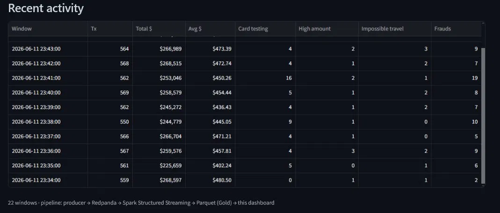
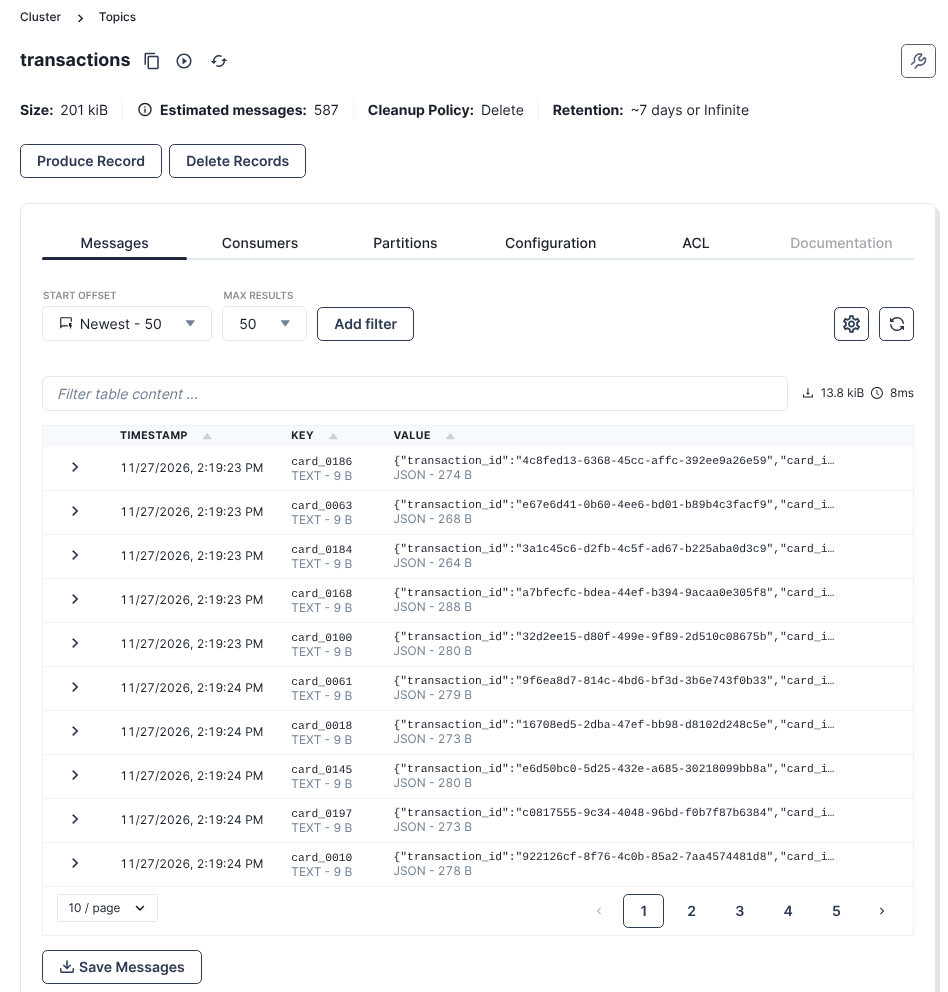

# Real-Time Fraud Stream Monitor

[](https://github.com/DiegoTDDD/realtime-fraud-streaming/actions/workflows/tests.yml)
[](https://github.com/DiegoTDDD/realtime-fraud-streaming/actions/workflows/pipeline-check.yml)
[](LICENSE)

**Problem.** Card fraud happens in seconds, and its signal is in patterns over time, such as a burst of tiny charges or a purchase far from home, rather than in any single transaction. A nightly batch report sees it a day late.

**Solution.** A streaming pipeline that moves card transactions from Redpanda (Kafka API) through Spark Structured Streaming into Parquet layers and a live dashboard. It counts every fraud pattern per minute, and every event is checked against a contract on the way in.

- **Live dashboard:** [realtime-fraud-streaming.streamlit.app](https://realtime-fraud-streaming.streamlit.app) (serves a recorded sample, see [ADR 0006](docs/adr/0006-static-sample-for-the-public-dashboard.md))
- **Design decisions:** [`docs/adr/`](docs/adr/README.md)
- **Used by:** [realtime-fraud-detection-ml](https://github.com/DiegoTDDD/realtime-fraud-detection-ml), which scores this same stream with an XGBoost model

---

## What it does

| | |
|---|---|
| Throughput | ~10 transactions per second from the producer, keyed by card over 3 partitions |
| Fraud injected | 3 labelled patterns, about 7.5% of events (card-testing bursts are most of it) |
| Gold output | One row per minute: count, total and average amount, fraud by pattern |
| Latency to Gold | A minute is written about 2 minutes after it ends (watermark for late events) |
| Data quality | Every event is checked against one contract by the producer and again by Spark. Failures go to `data/quarantine/` with the reasons, never to Gold |
| Tests | 24 unit tests, including Spark on a local session and a check that the producer and Spark reject the same events for the same reasons |
| CI | The full pipeline runs on Linux (Redpanda in Docker) and on Windows (Kafka) |

---

## Architecture

```
┌────────────┐     ┌────────────┐     ┌─────────────────────┐     ┌──────────────┐     ┌─────────────┐
│  Producer  │     │  Redpanda  │     │  Spark Structured   │     │   Parquet    │     │  Streamlit  │
│  (Python)  │ ──▶ │ (Kafka API)│ ──▶ │  Streaming          │ ──▶ │  Bronze/Gold │ ──▶ │  Dashboard  │
│            │     │            │     │                     │     │              │     │             │
│ card txns  │     │  topic:    │     │ windowed aggs +     │     │  layered     │     │ live KPIs + │
│ + injected │     │ transactions│    │ watermarking        │     │  storage     │     │ alerts      │
│ fraud      │     │ 3 partitions│    │                     │     │              │     │             │
└────────────┘     └────────────┘     └─────────────────────┘     └──────────────┘     └─────────────┘
```

**Producer** (`producer/producer.py`) emits ~10 transactions per second. Each carries a card id, amount, merchant, category, city, timestamp and ground-truth labels (`is_fraud`, `fraud_type`). About 2% of new transactions start an injected fraud; a card-testing episode adds a burst of 5 to 12 extra probe charges. Every event is checked against the contract before sending.

**Contract** (`contract/transaction.py`): the fields, their types, the allowed fraud types and five rules (`invalid:<field>`, `bad_timestamp`, `amount_not_positive`, `unknown_fraud_type`, `label_mismatch`). The producer and the Spark job enforce the same contract ([ADR 0004](docs/adr/0004-event-contract-and-quarantine.md)).

**Redpanda** is a Kafka-compatible broker in one container ([ADR 0001](docs/adr/0001-redpanda.md)). The `transactions` topic is keyed by card id, so each card's events stay in order ([ADR 0005](docs/adr/0005-partition-by-card.md)).

**Spark Structured Streaming** (`spark/streaming_job.py`, transformations in `spark/transforms.py`) runs three queries:
- **Bronze:** every event as received.
- **Quarantine:** events that break the contract, with the reasons.
- **Gold:** 1-minute tumbling windows on event time, with a 2-minute watermark, over the valid events ([ADR 0002](docs/adr/0002-windows-and-watermark.md), [ADR 0003](docs/adr/0003-bronze-gold-parquet.md)).

**Streamlit dashboard** reads Gold and shows headline counters, a throughput timeline, fraud by pattern and a table of recent windows with alerts.

---

## The three fraud patterns

| Pattern | Behavior | How it shows up |
|---|---|---|
| **High amount** | A single charge far above the category norm | Spikes in the high-amount series |
| **Card testing** | A burst of small "probe" charges on one card in seconds | Clusters in the card-testing series; the dominant pattern by volume |
| **Impossible travel** | A charge in a city other than the card's home city (ordinary purchases also happen away from home, about 13.5% of the time) | Steady low-rate background in the impossible-travel series |

Card testing arrives in bursts, so it dominates the per-minute fraud counts even though high-amount and impossible-travel are seeded at similar base rates. The dashboard's stacked fraud chart makes this behavior visible at a glance.

---

## Dashboard

### Overview & throughput


### Fraud signals by type


### Recent activity & alerts



### Redpanda Console — live messages



---

## Running it locally

### Prerequisites

- **Docker Desktop** (with WSL 2 enabled on Windows)
- **Python 3.11** — a conda environment is recommended
- **Java 17** — Spark runs on the JVM. Java 8 causes compatibility issues; install Java 17 isolated in the conda env:
  ```bash
  conda install -c conda-forge openjdk=17 -y
  ```
- **Windows only — Hadoop native binaries.** Spark needs `winutils.exe` and `hadoop.dll` to write files on Windows. Place both in `C:\hadoop\bin` (downloadable from the community `cdarlint/winutils` repo, version 3.3.x). The streaming job points `HADOOP_HOME` there automatically. `winutils.exe` needs the Microsoft Visual C++ 2010 runtime: if running `C:\hadoop\bin\winutils.exe ls C:\hadoop` fails, install the "Microsoft Visual C++ 2010 Redistributable (x64)" (for example `choco install vcredist2010`); without it Spark cannot create its checkpoint folders.

### Steps

1. **Create and activate the environment**
   ```bash
   conda create -n fraud python=3.11 -y
   conda activate fraud
   ```

2. **Install dependencies**
   ```bash
   pip install -r requirements.txt
   ```

3. **Start Redpanda**
   ```bash
   docker compose up -d
   docker exec -it redpanda rpk topic create transactions -p 3
   ```

4. **Start the Spark streaming job** (terminal 1)
   ```bash
   python spark/streaming_job.py
   ```
   The first run downloads the Spark–Kafka connector from Maven, so it needs internet access (it is cached afterwards).
   The connector version in `spark/streaming_job.py` (`KAFKA_PKG`) must match the PySpark version in `requirements.txt` (3.5.8).

5. **Start the producer** (terminal 2)
   ```bash
   python producer/producer.py
   ```

6. **Launch the dashboard** (terminal 3)
   ```bash
   streamlit run dashboard/app.py
   ```

Open `http://localhost:8501` for the dashboard and `http://localhost:8080` for the Redpanda Console.

Events that break the contract land in `data/quarantine/` with the reasons. **Upgrading from a version without the quarantine query:** delete `data/_checkpoints/` first, because the Gold query's plan has changed.

---

## Design decisions

| Decision | Why |
|---|---|
| [Redpanda](docs/adr/0001-redpanda.md) | Kafka API in one container, with no ZooKeeper |
| [Event-time windows, 2-minute watermark](docs/adr/0002-windows-and-watermark.md) | Late events land in the right minute, and Spark's state stays small |
| [Bronze and Gold in Parquet](docs/adr/0003-bronze-gold-parquet.md) | No services to run. Bronze can be replayed and Gold is small |
| [Shared event contract, quarantine](docs/adr/0004-event-contract-and-quarantine.md) | Bad events are visible instead of silently becoming nulls in Gold |
| [Key by card_id, 3 partitions](docs/adr/0005-partition-by-card.md) | Per-card order for burst detection and for the ML scoring job |
| [Committed sample for the public dashboard](docs/adr/0006-static-sample-for-the-public-dashboard.md) | The free host cannot run Spark or a broker |

What the project shows:

- **Stream processing** — Spark Structured Streaming with tumbling windows and event-time watermarking to handle late, out-of-order events
- **Event streaming** — Redpanda (Kafka API): topic design, partitioning by key, message inspection
- **Data modeling** — medallion Bronze/Gold layering applied to a streaming source
- **Containerization** — Docker Compose for the broker and console
- **Pipeline design** — decoupled producer / broker / processor / storage / dashboard, each independently runnable
- **Data visualization** — a purpose-built live monitoring dashboard with alerting
- **Domain framing** — fraud patterns modeled the way real detection systems categorize them, with ground-truth labels for downstream ML

---

## Limitations

- **Synthetic stream.** The fraud patterns are simple and fixed, and the labels come from the producer.
- **Small files.** Streaming writes many small Parquet files. A long-running deployment would need compaction (Delta Lake, or a periodic job).
- **Dashboard lag.** It runs about 3 minutes behind real time, because each window waits for the watermark. Events more than 2 minutes late are kept in Bronze but left out of Gold.
- **No schema registry.** The contract is a Python module shared in this repository. Several teams publishing to the topic would need a registry with compatibility rules (Avro or Protobuf).
- **Single local deployment.** One broker and local Spark, with no replication or monitoring of the queries.

---

## Project layout

```
realtime-fraud-streaming/
├── docker-compose.yml        # Redpanda + Console
├── contract/
│   └── transaction.py        # event contract shared by the producer and Spark
├── producer/
│   └── producer.py           # transaction generator with injected fraud
├── spark/
│   ├── streaming_job.py      # Spark Structured Streaming: Bronze, quarantine, Gold
│   ├── transforms.py         # parsing, contract check, Gold windows (unit-tested)
│   └── export_sample.py      # consolidates Gold into a deploy sample
├── dashboard/
│   ├── app.py                # Streamlit live dashboard
│   └── requirements.txt      # lightweight deps for the deployed dashboard
├── tests/                    # pytest: contract, producer, Spark transformations
├── data/
│   ├── bronze/               # raw transactions (gitignored)
│   ├── quarantine/           # events that broke the contract (gitignored)
│   ├── gold/                 # windowed aggregates (gitignored)
│   └── gold_sample/          # small sample for the deployed dashboard
├── docs/
│   ├── adr/                  # architecture decision records
│   └── screenshots/
├── .github/                  # CI: tests, pipeline, Windows, dashboard, security, app health
├── pyproject.toml            # project metadata, pytest and ruff settings
├── requirements.txt          # full local pipeline dependencies
└── requirements-test.txt     # unit tests (needs Java 17)
```

---

## Automated checks

- **Tests** (`tests.yml`) run on every push and pull request: `ruff` (including type hints on every function in `producer/`, `spark/` and `contract/`, and no `print` there) and 24 unit tests. They cover the contract rules, 3,000 generated events checked against the contract, the fraud patterns, Spark parsing, quarantine and Gold windows on a local SparkSession, and a check that Spark and the producer give the same reasons for the same messages.
- **Pipeline check** (`pipeline-check.yml`) runs the real pipeline on a GitHub runner: Redpanda in Docker, the producer and the Spark Structured Streaming job, waits until Bronze and Gold Parquet files contain data, checks their columns and opens the dashboard.
- **Windows check** (`windows-check.yml`) runs the README steps on Windows with conda, against Apache Kafka.
- **Security audit** (`security-audit.yml`) audits every `requirements*.txt` with `pip-audit` whenever dependencies change and every Monday. It fails only when a vulnerable package has a fixed version available.
- **App health** (`app-health.yml`) opens the [live app](https://realtime-fraud-streaming.streamlit.app) in a real browser after each push and once a day (waking it if it was asleep) and fails if the app shows an error.
